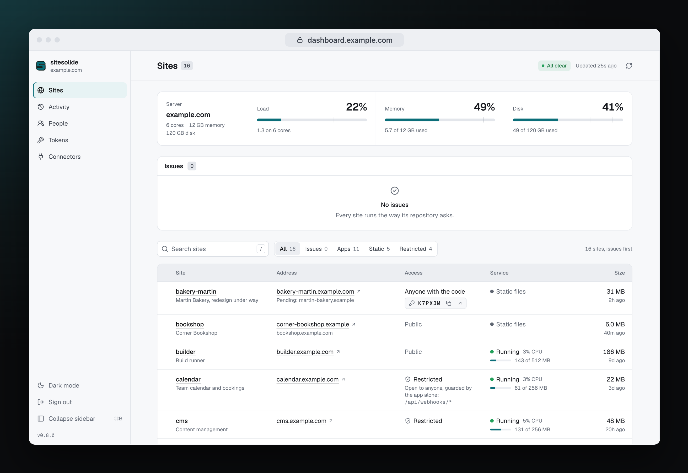

<h1>
  <picture>
    <source media="(prefers-color-scheme: dark)" srcset="docs/assets/logo-dark.svg">
    
  </picture>
</h1>

**A small cloud for the software your company and its agents write, on one
server you own.**

Internal tools, dashboards, prototypes: `sitesolide deploy` in a folder, typed
by you or run by an agent, puts it live on HTTPS, behind your company's
sign-in, open to exactly the people who need it. One machine, no
containers, no per-seat pricing.



## Quick start

You need a domain, at any registrar, and an account at Hetzner, DigitalOcean,
AWS, Google Cloud, Azure, Vultr, Akamai (Linode) or Scaleway, or any Debian 13
machine you reach over SSH.

```bash
curl -fsSL https://github.com/cthiriet/sitesolide/releases/latest/download/install.sh | sh
```

```bash
sitesolide setup
```

```bash
cd your-project && sitesolide deploy
```

One executable, no Bun and no clone. `sitesolide setup` asks which cloud,
region and size, checks your domain at its DNS provider, shows the plan with its
price, then orders the machine, hardens it, creates the DNS records where your
DNS provider has an API sitesolide speaks (or lists the two to create by hand),
and installs everything; it can be run again at any time. Without questions, for a
script or an agent, the same is two commands:

```bash
sitesolide machine create --provider hetzner --name web
```

```bash
sitesolide setup root@203.0.113.10 --zone example.com --email you@example.com
```

[docs/install.md](docs/install.md) explains each step and the tokens they read.
A new release later: install it the same way, then `sitesolide upgrade`
redeploys what changed, see [docs/upgrading.md](docs/upgrading.md).

## What you get

- **HTTPS for every project**, at `<project>.example.com`, and on a client's own
  domain once its DNS points at your machine.
- **Apps in any language.** A static site, or anything that listens on a port:
  Node, Python, Go, Ruby, a binary, each confined to its own user and folder.
- **Background work.** Workers that run for good and jobs on a schedule,
  beside a site or on their own, confined the same way and yielding the
  processor to the sites.
- **Company sign-in, access given like a doc's.** Google Workspace, Microsoft
  Entra, Okta or any OpenID Connect provider in front of private apps, opened
  to people or a whole domain, each with a role, from opening the site to
  looking after the project: `sitesolide share alice@example.com`. Someone
  outside the company gets password access. See
  [portal/README.md](portal/README.md).
- **Personal tokens instead of root SSH.** Colleagues and agents deploy with a
  personal, scoped, revocable token, never stronger than its holder's roles;
  only the owner holds SSH.
- **Secrets on the server**, never in git: `sitesolide.json` lists their
  names, the server keeps each project's values in its own store, set from
  the dashboard or with `sitesolide secrets set API_KEY`, typed at a prompt,
  or drawn on the server with `sitesolide secrets generate`. Only the owner
  reads a value back, in the dashboard; a deploy never stops on a missing
  one, it asks for it or says so.
- **Backups.** Every project's data snapshotted hourly into restic, SQLite
  copied consistently, restored from the dashboard, and copied encrypted to a
  bucket once you configure one.
- **A monitor** that checks every site each minute; give it a heartbeat and it
  notices the machine itself dying. See [monitor/README.md](monitor/README.md).
- **Agents first-class.** The CLI speaks `--json`, every error carrying a hint,
  and `sitesolide mcp` serves deploy, logs and access to Claude Code, Codex or
  Cursor.

## What it does not do

- **Zero-downtime deploys.** A deploy sends the new code over the running
  version and restarts the service: a visitor gets a 502 until the new process
  listens. Nothing keeps the previous version, and the way back is a deploy of
  the previous commit. See
  [what a deploy costs](docs/concepts.md#what-a-deploy-costs).
- **Backups off the machine, by default.** The snapshots stay on the server's
  disk until you give it a bucket, and a lost server takes them with it.
- **Reboots.** Security updates install every day, but nothing reboots for a
  new kernel: that is yours to do, see
  [updates and reboots](docs/concepts.md#updates-and-reboots).
- **Failover.** One machine; when it is down, every site is.

## Documentation

- [Install](docs/install.md): from nothing to a first deployment
- [Setup](docs/setup.md): what `sitesolide setup` checks and changes, step by step
- [A machine](docs/machine.md): a VM ordered from a cloud, and the credentials it needs; [each cloud](docs/providers/)
- [How it works](docs/concepts.md): the parts, and who may touch what
- [The manifest](docs/manifest.md): every key of `sitesolide.json`
- [Commands](docs/commands.md): everything the CLI does
- [People and tokens](docs/access.md): roles on a project, and deploying with a token instead of SSH
- [Secrets](docs/secrets.md): what goes in `env`, in the server's store, in a file, or with whoever deploys, and why never in git
- [Agents](docs/agents.md): `--json`, the MCP server and the skill
- [Upgrading](docs/upgrading.md): from one release to the next on a running machine

An agent starts with [llms.txt](llms.txt).

## Security

Report a vulnerability privately, never in a public issue: see
[SECURITY.md](SECURITY.md), which also says what is in scope and what the
design does not protect.

## License

MIT, see [LICENSE](LICENSE). Contributions welcome, see
[CONTRIBUTING.md](CONTRIBUTING.md).
